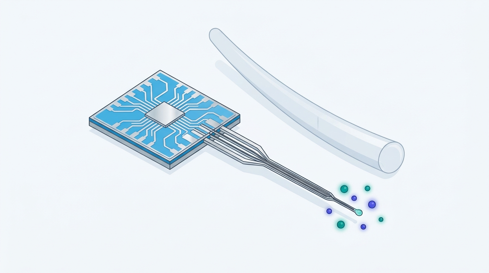

# Implantable Neurochemical Biosensors & CMOS AFE Dashboard

[](https://qauzrck.github.io/Implantable-Neurochemical-Biosensors-MEAs/)
[](https://qauzrck.github.io/Implantable-Neurochemical-Biosensors-MEAs/?lang=en)
[](#project-structure)
[](LICENSE)

An interactive, bilingual (**Thai / English**) biomedical & electrical engineering synthesis dashboard exploring **implantable electrochemical biosensors**, **low-noise CMOS potentiostats**, **chemometric/AI decoders**, and **closed-loop Deep Brain Stimulation (DBS)** for real-time neurotransmitter monitoring.

<p align="center">
  
</p>

---

## Key Engineering Highlights

| Subsystem | Benchmark / Specification | Significance |
| :--- | :--- | :--- |
| **Electrode Footprint** | `7 µm` CFME (`~100 µm` tip) | ~30–40× smaller than microdialysis (`200–300 µm`), minimizing tissue & vascular damage |
| **Nanomaterial Sensitivity** | `2.03 nM` LoD (`PEDOT-CNT` SWV) · `46 nA/µM` (`PEDOT:Nafion`) | Resolves nanomolar dopamine & serotonin with `1540×` AA interferent rejection |
| **Mechanical Compliance** | `< 30 kPa` brain vs. `1.9 MPa` (`SEBS` / `PDMS`) | Eliminates `10⁵–10⁶×` silicon stiffness mismatch to suppress glial scarring |
| **CMOS Potentiostat AFE** | `26.5 / 39.2 pArms` noise (`5 kHz` BW) · `3.74 µW` power | `83 dB` effective dynamic range while rejecting `290 nApp` charging backgrounds |
| **Closed-Loop DBS Control** | `10 Hz` FSCV → `100 Hz` Butterworth → `150N` ANN | Tunes stimulation frequency (`~100 Hz`) & pulse width (`0.1–2.0 ms`) in real time |

---

## What's Inside (Modules 0–7)

| Module | Topic | Interactive Features |
| :--- | :--- | :--- |
| **0. Start Here (Intro)** | Plain-language guide with visual analogies | 4-question beginner overview & 4-step visual story (`assets/how-it-works-steps.jpg`) |
| **1. Overview & Bottlenecks** | System co-design & translational barriers | Interactive SVG signal-chain diagram & 4-pillar bottleneck explorer |
| **2. FSCV Physics** | Phasic vs. Tonic electrochemistry | Real-time **FSCV Physics Simulator** (`Scan Rate`, `C_dl`, `[DA]`), 1-click presets, & 7-modality filterable table |
| **3. Electrode Materials** | Nanomaterials & compliant mechanics | `LoD` vs. `Sensitivity` benchmark chart, Young's modulus log comparison, & 7-material inspector |
| **4. CMOS AFE** | Low-noise potentiostat architectures | Log-scale Noise vs. Area bubble plot, **Hall et al. Noise Calculator**, topology selector, & 6-chip table |
| **5. Clinical & DBS** | Chemometrics, disease models & closed-loop DBS | 4 clinical domain tabs, 5-stage DBS pipeline, & **Stimulus Parameter Explorer** |
| **6. Real-World (IRL)** | Clinical & industrial translation | 6-scenario IRL deployment explorer & legacy vs. modern readiness table |
| **7. Research Report** | Complete technical synthesis | Collapsible accordion report with **Expand/Collapse All**, **Copy**, and **Print / PDF** export |

---

## Features & UX

- **Bilingual Thai / English Switcher (`🇹🇭 ไทย` / `🇺🇸 EN`)** with `localStorage` persistence and `?lang=en` / `?lang=th` URL support.
- **Light / Dark Mode Toggle (`🌙` / `☀️`)** that dynamically updates card surfaces, typography, SVG diagrams, and all 5 Chart.js visualizations.
- **Comfort Reading & Navigation**: Slim `Prompt` + `Inter` + `JetBrains Mono` typography, reading progress bar, Scroll-Spy active navigation pills, and Back-to-Top button.

---

## Project Structure

```text
Implantable-Neurochemical-Biosensors-MEAs/
├── index.html                  # Semantic 8-module dashboard layout
├── css/
│   └── styles.css              # Light/Dark CSS variables, typography, accordions, print styles
├── js/
│   ├── data.js                 # Bilingual (TH/EN) datasets for Modules 1–6
│   ├── i18n.js                 # TH/EN translation engine, theme switcher, Chart.js theming
│   └── app.js                  # Interactive simulators, Chart.js charts, Scroll-Spy & UX controls
├── assets/
│   ├── biochip-overview.jpg    # Hair-scale biochip & microelectrode illustration
│   └── how-it-works-steps.jpg  # 4-step closed-loop neurochemical workflow illustration
├── .gitignore
├── LICENSE
└── README.md
```

---

## Quick Local Preview

No build step or package installation is required—everything runs with pure static HTML/CSS/JS (plus Tailwind & Chart.js CDNs).

**Option 1 — Open directly**
Double-click `index.html` in your file explorer.

**Option 2 — Run a local static server (Node.js)**
```powershell
npx serve .
```
Or using **VS Code Live Server** (`Right-click index.html` → `Open with Live Server`).

---

## License

This project is licensed under the [MIT License](LICENSE).
